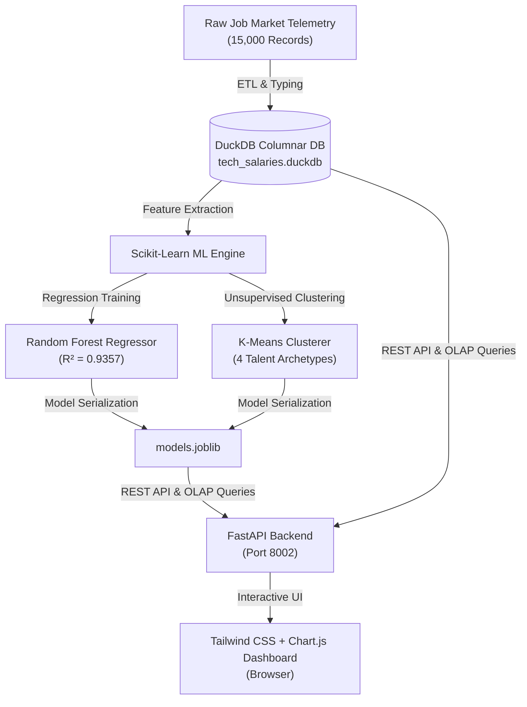

# 🌐 Tech Career & Global Remote Salary Intelligence (2026 Benchmark)

[](https://python.org)
[](https://duckdb.org)
[](https://scikit-learn.org)
[](https://fastapi.tiangolo.com)
[](https://tailwindcss.com)
[](LICENSE)

Análise preditiva e forense de alta performance sobre o mercado global de trabalho em tecnologia e contratações remotas em moeda forte (**Dólar / Euro vs Real Brasileiro**), cobrindo **15.000 posições de 2024 a 2026**.

---

## 🚀 Destaques do Projeto

- **DuckDB Analytical Engine:** Ingestão colunar ultra-rápida de 15.000 posições tecnológicas globais com consultas SQL de baixa latência (< 5ms).
- **Machine Learning Preditivo (Random Forest Regressor):** Modelo treinado com **R² Score de 93,57%** e MAE de US$ 19k para estimativa salarial precisa baseada em senioridade, região, fluência em inglês e stack de habilidades.
- **Clusterização de Talentos (K-Means):** Identificação de 4 grandes arquétipos de mercado (AI/LLM Specialists, Cloud Architects, Modern Data Engineers, Fullstack & Web3 Builders).
- **Dashboard Interativo em Tempo Real:** Interface moderna, responsiva e em modo escuro com **Tailwind CSS + Chart.js**, dispensando dependências pesadas de Streamlit.
- **Execução em 1 Clique no Windows:** Script `iniciar.bat` pronto para uso com inicialização e abertura automática do navegador.

---

## 📊 Arquitetura do Sistema



---

## 📈 Principais Descobertas Forenses (2026 Live)

| Métrica | Benchmark Global | Detalhes |
|---|---|---|
| **Salário Médio Global** | **US$ 204.708 / ano** | ≈ R$ 1.187.300 / ano (~R$ 98.900 / mês) |
| **Prêmio de AI / LLM** | **+35% a +50%** | Posições com PyTorch, LangChain, RAG e VectorDB |
| **Penetração Remoto Global** | **74.8%** | Vagas com contratação internacional direta em US$ |
| **Multiplicador de Inglês Fluente** | **+25%** | Diferencial decisivo frente ao nível intermediário |
| **Acurácia Preditiva (R²)** | **93.57%** | Base explicativa sólida sobre 12 variáveis de mercado |

---

## 🧬 4 Arquétipos de Mercado (K-Means Clusters)

1. **AI & LLM Specialists (Cluster #0):** Foco em modelos fundacionais, RAG, agentes autônomos e fine-tuning. Maior remuneração média da categoria.
2. **Cloud & High-Throughput Distributed Systems (Cluster #1):** Arquitetos de Kubernetes, AWS e microsserviços resilientes.
3. **Modern Data Platform Engineers (Cluster #2):** Engenharia analítica moderna com DuckDB, Snowflake, dbt e lakehouses em tempo real.
4. **Fullstack & Web3 Builders (Cluster #3):** Desenvolvedores de produto de ponta a ponta, dApps, contratos inteligentes e interfaces de alta retenção.

---

## 🛠️ Como Executar

### 1. Execução Rápida (Windows)
Basta dar um duplo clique no arquivo **`iniciar.bat`** ou executar no prompt:
```bat
iniciar.bat
```
O script instalará dependências, gerará o banco DuckDB, treinará os modelos de ML e abrirá o dashboard automaticamente em seu navegador (`http://127.0.0.1:8002`).

### 2. Execução Manual via Terminal
```bash
# Instalar dependências
pip install -r requirements.txt

# Gerar banco DuckDB
python data/generate_dataset.py

# Treinar modelos de Machine Learning
python ml/train_models.py

# Iniciar servidor FastAPI
python -m uvicorn app.main:app --host 127.0.0.1 --port 8002
```
Acesse: [http://127.0.0.1:8002](http://127.0.0.1:8002)

---

## 👨‍💻 Autor

- **Tássio Sales** - [@TassioSales](https://github.com/TassioSales)
- Projeto desenvolvido como parte do ecossistema de inteligência de dados aplicada.
